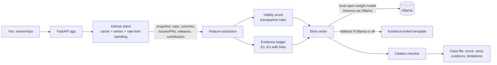

# 🪦 The Software Cemetery

> **FOSS has feelings. The receipts have links.**
> Type in any public GitHub repository and get a kind, funny life story for it, written by a **local open-weight model (Gemma via Ollama)** and backed by a vitality score and an evidence ledger you can click and verify.

*Submission for the [Hacktoberfest Open-Source AI Challenge, Week 4: Ghost in the Machine](https://dev.to/challenges/hacktoberfest-week4-2026-10-26)* 👻🌼

[](LICENSE)

-orange)

---

## Table of contents

1. [What it is](#1-what-it-is)
2. [How it fits the "Ghost in the Machine" theme](#2-how-it-fits-the-ghost-in-the-machine-theme)
3. [Demo](#3-demo)
4. [Quick start](#4-quick-start)
5. [How it works](#5-how-it-works)
6. [The open-source AI at the core](#6-the-open-source-ai-at-the-core)
7. [How the vitality score is calculated](#7-how-the-vitality-score-is-calculated)
8. [Usage: web app, CLI and API](#8-usage-web-app-cli-and-api)
9. [Configuration](#9-configuration)
10. [Project structure](#10-project-structure)
11. [Tests](#11-tests)
12. [Deploying](#12-deploying)
13. [Honest limitations](#13-honest-limitations)
14. [Challenge window and attribution](#14-challenge-window-and-attribution)
15. [License](#15-license)

---

## 1. What it is

Some open-source projects go quiet. Maintainers move on, jobs change, life happens. The Software Cemetery gives those repositories a respectful send-off, **without pretending that quiet means dead.**

For any public repository it:

1. **Collects public traces** from the GitHub REST API: repository details, recent commits, issues and PRs, releases and contributors.
2. **Scores its vitality** (0-100) with a transparent, auditable rule set (no black box).
3. **Builds an evidence ledger**: numbered claims (`E1`, `E2`, ...) that each link to the exact GitHub page that supports them.
4. **Writes a life story / epitaph**, nostalgic, lightly sarcastic about TODOs and weekend refactors (never about maintainers), where every factual sentence cites an evidence ID like `[E4]`.
5. **Checks the citations in code**: any `[E#]` the story invents that is not in the ledger is flagged.

**Who it is for:** people deciding whether a dependency is safe to adopt, contributors looking for a project that needs revival, and anyone who enjoys a good open-source ghost story.

## 2. How it fits the "Ghost in the Machine" theme

The week 4 theme asks for something spooky, or something that honors the past in the spirit of Día de los Muertos. This project is a digital **ofrenda for abandoned open-source work**:

- Every repository gets a memorial with a pixel-art cemetery, a CRT/terminal look and a story told with warmth.
- The tone follows the Día de los Muertos spirit: *remember with affection, don't mock.* The story always ends with a practical revival suggestion (read the latest issues, check the contributing guide, ask whether help is welcome).
- It brings forgotten corners of open source back into view, which is one of the challenge's own suggested ideas.

## 3. Demo

| | |
|---|---|
| **Live demo** | `<ADD YOUR LIVE URL HERE>` |
| **Video** | `<ADD YOUR VIDEO URL HERE>` |
| **DEV post** | `<ADD YOUR DEV POST URL HERE>` |

The app also ships an **Illustrative sample case** (clearly labelled synthetic, not real GitHub data) so the UI can be explored with no token and no internet.

## 4. Quick start

You need **Python 3.10+** (3.11 or 3.12 recommended). Local AI stories need [Ollama](https://ollama.com); everything else works without it.

### Windows (PowerShell)

```powershell
git clone https://github.com/KomalDeep355/software-cemetery.git
cd software-cemetery
py -3.12 -m venv .venv
.\.venv\Scripts\Activate.ps1
python -m pip install --upgrade pip
pip install -r requirements.txt
Copy-Item .env.example .env
pytest -q
uvicorn cemetery.web:app --reload
```

### macOS / Linux

```bash
git clone https://github.com/KomalDeep355/software-cemetery.git
cd software-cemetery
python3 -m venv .venv && source .venv/bin/activate
pip install -r requirements.txt
cp .env.example .env
pytest -q
uvicorn cemetery.web:app --reload
```

Open **http://127.0.0.1:8000**, type `owner/repo` (or paste a GitHub URL) and press the arrow.

### Strongly recommended: add a GitHub token

Without a token GitHub allows only **60 requests per hour per IP**, and each investigation uses about 5 requests. Add a token (no scopes needed for public data) to `.env`:

```env
GITHUB_TOKEN=ghp_your_token_here
```

Never commit `.env`. It is already in `.gitignore`.

### Turn on the local AI story (Gemma)

```bash
ollama pull gemma3:4b
ollama serve          # if it is not already running
```

Then tick **"Ask local Gemma/Ollama to write the eulogy"** in the app (it is on by default), or pass `--llm` in the CLI. If Ollama is not reachable, the app **falls back automatically** to a deterministic, evidence-linked template and shows a note explaining why.

## 5. How it works



| Step | File | What happens |
|---|---|---|
| 1 | `cemetery/github_client.py` | `snapshot()` fetches ~5 API calls (repo, commits, issues/PRs, releases, contributors), with on-disk caching, retries and rate-limit waiting |
| 2 | `cemetery/features.py` | Turns the raw snapshot into numbers (days since last commit, contributor concentration, release age, ...) |
| 3 | `cemetery/vitality.py` | Public entry point for the score and its human-readable reasons |
| 4 | `cemetery/evidence.py` | Builds the numbered evidence ledger, each entry linked to GitHub |
| 5 | `cemetery/epitaph.py` | Writes the story with Gemma (Ollama) or the template, then verifies `[E#]` citations |
| 6 | `cemetery/pipeline.py` | Orchestrates steps 1-5 into one result |
| 7 | `cemetery/web.py`, `cli.py` | FastAPI web/API and command-line front doors |

## 6. The open-source AI at the core

- **Model:** [Gemma 3 (4B)](https://ai.google.dev/gemma), an open-weight model, run **locally through [Ollama](https://ollama.com)**. Swap it by changing `OLLAMA_MODEL` in `.env`.
- **Prompt design:** the model receives only the fetched facts (repository data, features, assessment, evidence ledger) and is instructed to use *only* those facts, cite `[E#]` after every claim, say plainly that inactivity is not proof of abandonment, and end with a practical revival suggestion.
- **Guardrails in code, not just in the prompt:** `verify()` extracts every `[E#]` and flags ids that are not in the ledger. If the model call fails or returns too little text, the app falls back to a template and tells you.
- **Privacy:** story generation happens on your own machine. The repository facts are never sent to a hosted AI API.

### Why open innovation matters here

- **It works with the lights off.** Once repository data is cached, the whole story can be generated with no internet and no AI vendor.
- **No lock-in, no bill.** A closed API could change its terms, price or disappear, which would be an ironic fate for a project about things that get abandoned. An open-weight model on your laptop costs nothing per story.
- **Inspectable and swappable.** The prompt, the model and the scoring rules are all visible and changeable.
- **Verifiable.** Open data (GitHub), an open model, and open scoring code mean every claim can be traced to a source.

## 7. How the vitality score is calculated

The score starts at **100** and subtracts for each warning sign. Every rule lives in `cemetery/features.py` (`assess`) so it can be audited in one place.

| Signal | Condition | Points removed |
|---|---|---|
| Last commit/push | no timestamp available | -25 |
| | more than 730 days ago | -48 |
| | 366-730 days ago | -35 |
| | 181-365 days ago | -20 |
| | 91-180 days ago | -10 |
| Last release | none found | -8 |
| | more than 730 days ago | -12 |
| | 366-730 days ago | -6 |
| Contributors | 1 or fewer observed | -12 |
| Concentration | one author has 85% or more of observed commits (with 2+ contributors) | -8 |
| Archived on GitHub | flag is set | score capped at **35** |

**Labels:** `Recently active` (180 days or fewer), `Cooling down` (181-365), `Quiet` (366-730), `Very quiet` (over 730), `Unknown activity`, `Archived`.

> ⚠️ This is a **heuristic about visible signals**, not a prediction of maintainer intent and not proof of abandonment. A finished, stable library can look "quiet" and be perfectly healthy.

## 8. Usage: web app, CLI and API

### Web app

| Section | What it does |
|---|---|
| **Investigate** | Inspect one repo: score, story, reasons, evidence ledger, limitations |
| **Compare** | Compare 2-5 repos side by side |
| **Case Explorer** | Your last 12 investigations, stored only in your browser's local storage |
| **Export** | Download a case as a Markdown report |
| **Archivist helper** | A small local FAQ assistant (not a hosted chatbot) |

### CLI

```bash
# One repository, deterministic story
python -m cemetery inspect pallets/flask --no-llm --output results/flask.json

# One repository, story written by local Gemma
python -m cemetery inspect pallets/flask --llm

# A batch (one owner/repo per line in the seeds file)
python -m cemetery collect --seeds data/seeds/repos.txt --output data/snapshots.jsonl
```

### HTTP API

| Method | Endpoint | Body / notes |
|---|---|---|
| GET | `/api/health` | Health check |
| POST | `/api/inspect` | `{"repo": "owner/repo", "use_llm": false}` |
| POST | `/api/compare` | `{"repos": ["a/b", "c/d"], "use_llm": false}` (2-5 repos) |
| GET | `/api/export/{owner}/{repo}` | Markdown report download |

Interactive API docs are served at `/docs`.

## 9. Configuration

Set these in `.env` (copy from `.env.example`):

| Variable | Default | Purpose |
|---|---|---|
| `GITHUB_TOKEN` | *(empty)* | Raises the GitHub rate limit from 60 to 5,000 requests/hour |
| `OLLAMA_URL` | `http://localhost:11434` | Where Ollama is running |
| `OLLAMA_MODEL` | `gemma3:4b` | Any model you have pulled in Ollama |
| `CACHE_TTL_SECONDS` | `43200` | How long GitHub responses are cached on disk (12 h) |
| `CACHE_DIR` | `data/cache` | Where cached responses are stored |

## 10. Project structure

```text
software-cemetery/
├── cemetery/
│   ├── __main__.py            # python -m cemetery
│   ├── cli.py                 # inspect / collect commands
│   ├── config.py              # environment configuration
│   ├── github_client.py       # GitHub REST client, cache, snapshot()
│   ├── features.py            # feature extraction + transparent score rules
│   ├── vitality.py            # public interface to the score
│   ├── evidence.py            # source-linked evidence ledger
│   ├── epitaph.py             # Gemma/Ollama story + template + citation check
│   ├── pipeline.py            # orchestrates one investigation
│   ├── benchmark.py           # metrics helpers for human-reviewed labels
│   ├── web.py                 # FastAPI app and API
│   ├── templates/index.html   # page structure
│   └── static/                # CRT/terminal CSS and JS
├── scripts/evaluate_benchmark.py
├── tests/                     # pytest suite (runs offline)
├── data/                      # seeds, examples, cache
├── docs/                      # costs, deployment notes, experiment notes
├── .env.example
├── LICENSE
└── README.md
```

## 11. Tests

```bash
pytest -q
```

The suite runs fully **offline** (GitHub is faked), covering repository-URL parsing, the snapshot shape, scoring, evidence ledger, citation checking and the full pipeline. One of the tests exists because of a real bug: the pipeline originally called a `snapshot()` method that the client did not implement, and the earlier tests did not notice because they used a fake client that had it. `tests/test_github_client.py` now checks the real client's `snapshot()`.

## 12. Deploying

**Render:** build command `pip install -r requirements.txt`, start command `uvicorn cemetery.web:app --host 0.0.0.0 --port $PORT`. Add `GITHUB_TOKEN` as an environment variable.

> Ollama will not be available on a typical free host, so a deployed instance uses the deterministic evidence-linked story. For the full local-Gemma experience, run it on your own machine. More notes are in `docs/SPONSORS_AND_DEPLOYMENT.md`.

## 13. Honest limitations

- A quiet repository is **not** proof of abandonment. The app reports observable signals, not intent.
- GitHub API data is a **recent sample** (latest commits, issues and releases), not a complete history.
- Citation markers prove an ID exists in the ledger, **not** that the sentence is semantically supported. Small local models can still slip, so check claims against the evidence links.
- The score weights are hand-set and have **not** been validated against a labelled benchmark. `scripts/evaluate_benchmark.py` is provided to measure accuracy once humans have labelled a sample; no benchmark results are claimed.
- The pricing tiers shown in the UI are hypothetical concepts. There is no billing.
- TabPFN is listed in `docs/TABPFN_EXPERIMENT.md` as a possible future experiment only. It is not used.

## 14. Challenge window and attribution

- Built for the Hacktoberfest Open-Source AI Challenge, Week 4 (October 26-31, 2026).
- Commits made after the submission deadline (October 31, 2026, 11:59 PM PDT): `<LIST THEM HERE, OR WRITE "none">`.
- Built with FastAPI, Requests, Jinja2, python-dotenv, scikit-learn, Ollama and Gemma. Data comes from the public GitHub REST API.
- AI assistance: parts of this project were developed with help from an AI assistant.

## 15. License

Released under the [MIT License](LICENSE). © 2026 Komal Deep.

---

*Remember: a quiet repo isn't a dead repo. Read the issues. Say hello. Maybe bring flowers. 🌼*